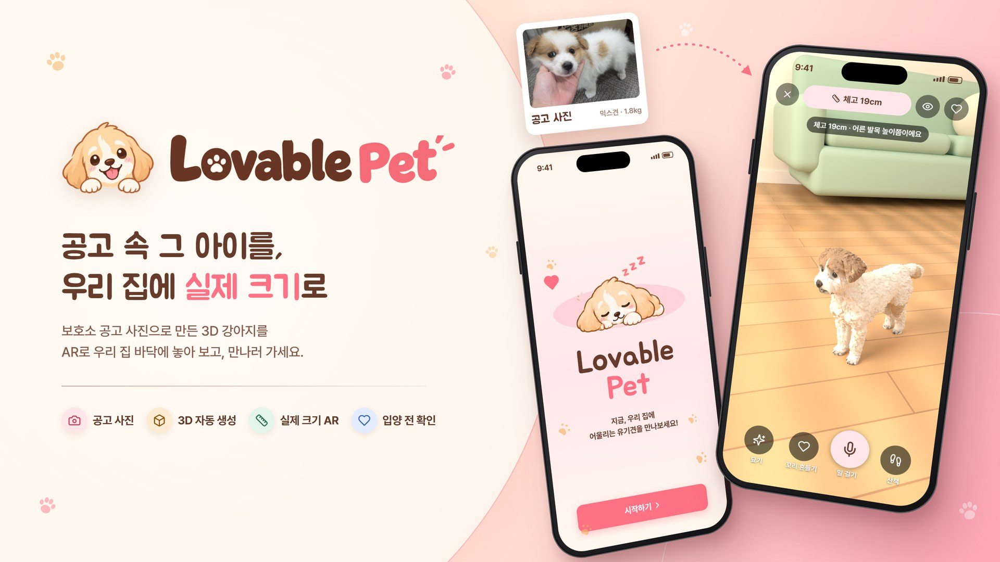
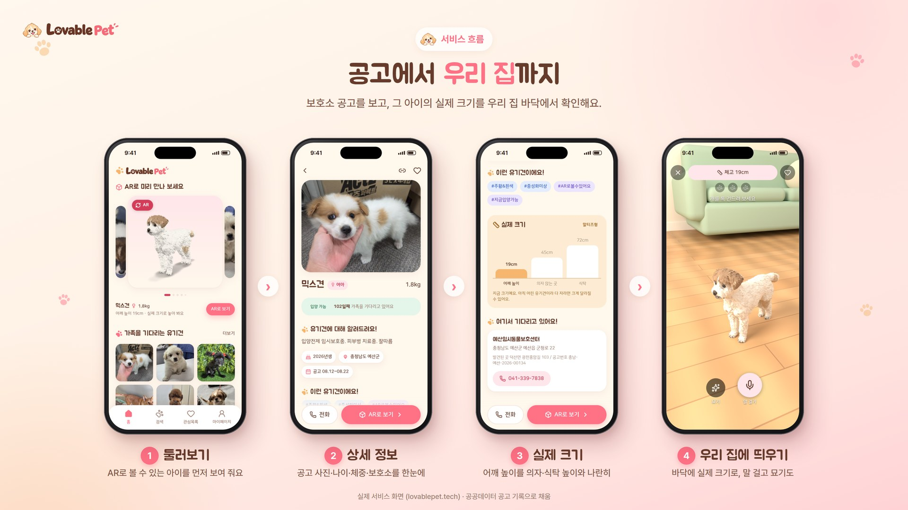
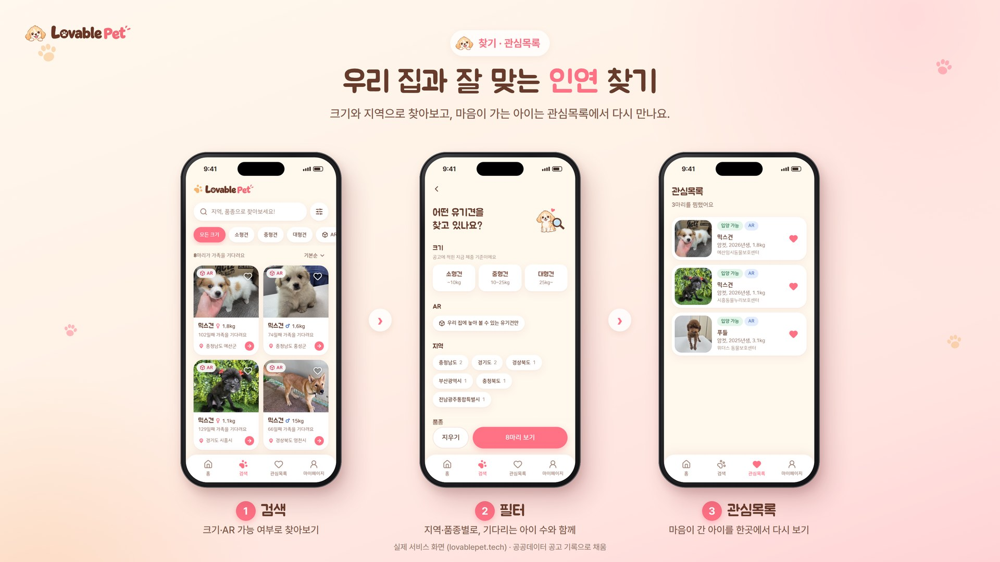
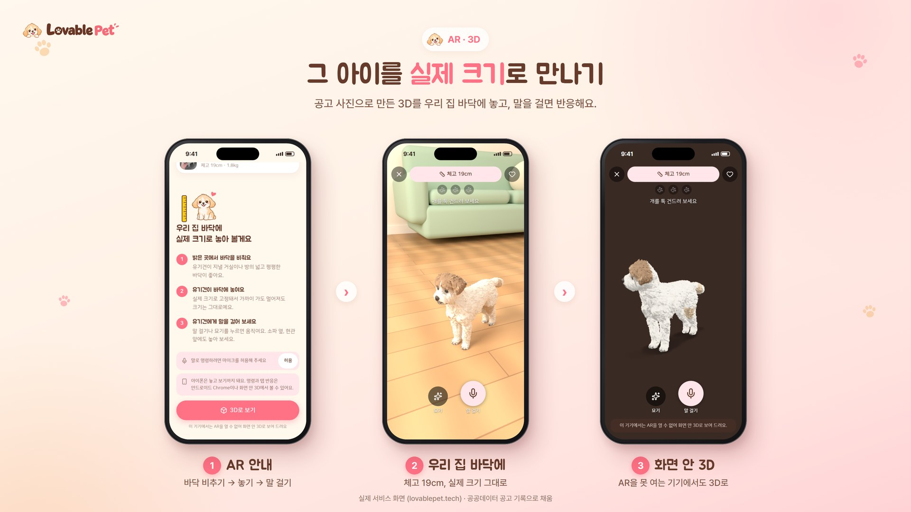
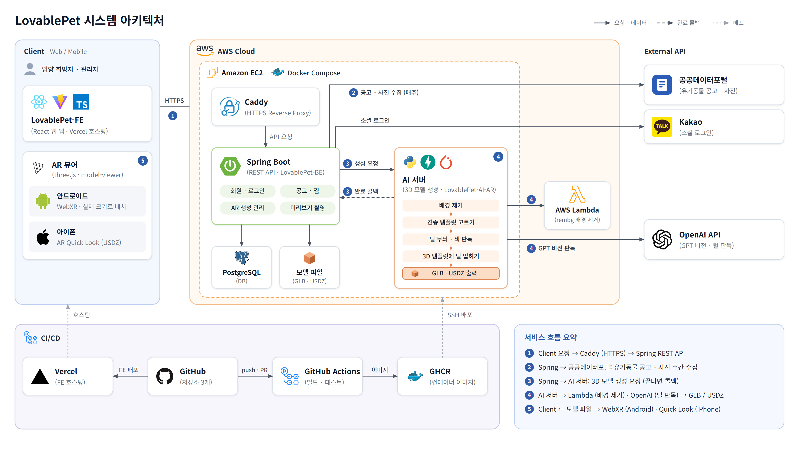

 

**보호소 강아지를 입양 전에 우리 집에 띄워, 실제 크기로 함께 지내는 모습을 미리 체험해 보는 AR 서비스**

 

 

## 🐾 왜 만들었나요

- 공고 사진만 봐서는 그 아이가 실제로 얼마나 큰지, 우리 집에 들어오면 어떤 모습일지 가늠하기 어려워요.
- Lovable Pet은 공공데이터포털의 유기동물 공고를 매주 모아 오고, **공고 사진으로 그 아이를 닮은 3D 강아지**를 만들어요.
- 만든 3D 강아지를 **AR로 우리 집 바닥에 실제 크기로** 놓아 보고, 말을 걸거나 묘기를 시켜 보며 먼저 만나 볼 수 있어요.

 

## 📱 서비스 화면

 

## 🏗️ 시스템 구조

 

## 📦 레포지토리

| 레포지토리 | 하는 일 | 기술 |
| :-- | :-- | :-- |
| [**LovablePet-FE**](https://github.com/Lovable-Pet/LovablePet-FE) | 웹 앱 화면, AR 화면 |        |
| [**LovablePet-BE**](https://github.com/Lovable-Pet/LovablePet-BE) | REST API, 공고 동기화, AR 생성 관리 |         |
| [**LovablePet-AI-AR**](https://github.com/Lovable-Pet/LovablePet-AI-AR) | 공고 사진으로 3D 강아지 만들기 (GLB · USDZ) |       |

 

## 👥 팀원과 역할

<table>
  <tr>
    <td align="center" width="33%"><a href="https://github.com/LeeJuYoung12"> <b>이주영</b></a> <b>팀장</b> · LeeJuYoung12 기획 · 인프라 · BE · AR 파이프라인 · 애니메이션</td>
    <td align="center" width="33%"><a href="https://github.com/taetu"> <b>김태우</b></a> <b>팀원</b> · taetu BE · AR 인터랙션 · 애니메이션</td>
    <td align="center" width="33%"><a href="https://github.com/anjaein"> <b>안재인</b></a> <b>팀원</b> · anjaein FE · UI 디자인</td>
  </tr>
</table>

| 팀원 | 맡은 일 |
| :-- | :-- |
| **이주영** <b>팀장</b> LeeJuYoung12 | **기획**: 서비스 기획 **인프라**: AWS EC2 · Docker Compose, Caddy HTTPS, GitHub Actions → GHCR 자동 배포와 스모크 테스트 **BE**: 프로젝트 초기 세팅, 공공데이터 유기동물 공고 동기화와 목록 · 상세 · 필터 API, AR 생성 관리 (파이프라인 연동, GLB · USDZ 제공), 관리자 권한 **AR 파이프라인**: 공고 사진 → 3D 강아지 생성 파이프라인 설계 · 개발 (배경 제거, 견종 템플릿 고르기, 털 무늬 · 색 판독, 템플릿에 털 입히기, 실제 크기 계산) **애니메이션**: 강아지 3D 동작 애니메이션 제작 |
| **김태우** <b>팀원</b> taetu | **BE**: 회원 · 로그인 (아이디 로그인, 카카오 로그인, JWT · 리프레시 토큰), 공통 응답 · 예외 처리, 찜 API **AR 인터랙션 (FE)**: 바닥 인식과 놓기 (깊이 센서, 장애물 둘레 검사), 음성 명령 · 길게 눌러 짖기, 산책 모드, 고개 바라보기 · 몸 돌리기, 짖는 소리 **애니메이션**: 강아지 3D 동작 애니메이션 제작 |
| **안재인** <b>팀원</b> anjaein | **디자인**: 와이어프레임, 디자인 시스템, 로고, 전체 화면 리디자인 **FE**: 프로젝트 초기 세팅 (Vite · React · Tailwind · Storybook), 둘러보기 · 검색 · 필터 · 상세 · 찜 · 로그인 · 마이 · 관리자 화면, API 연동과 토큰 재발급, MSW 목업, 첫 AR 화면 (model-viewer), CI · Vercel 배포 |
